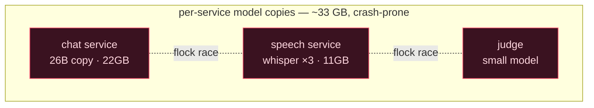
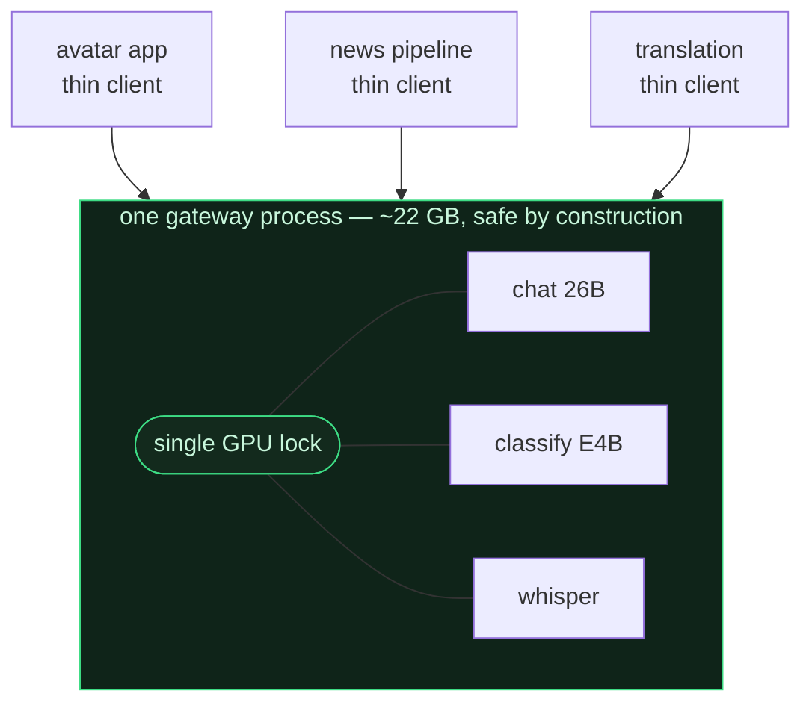
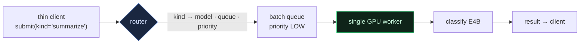
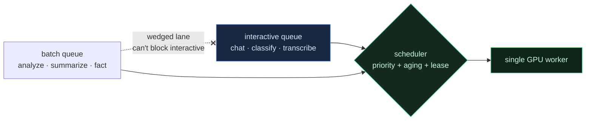
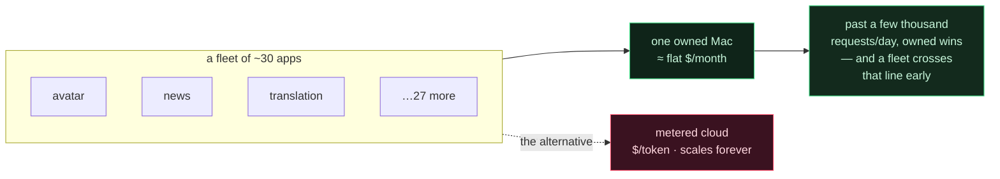

[🇺🇸 English](README.md) · [🇰🇷 한국어](README.ko.md) · [🇯🇵 日本語](README.ja.md) · [🇨🇳 简体中文](README.zh.md)

# Fleet Inference Gateway

**Apple Silicon の Mac 1 台で推論プロセスを 2 つ動かすと、互いにクラッシュする。これを逆手に取る — 1 つのプロセスに GPU 全体を持たせ、モデルではなく役割で呼び、fleet 全体の chat・分類・音声を 1 台で、電気代で回す。**

> [**NSKit**](https://github.com/nskit-io/nskit-io) で稼働中 — *構造には縛られ、組み合わせは自由に。* NSKit のオンプレ推論のゲートウェイであり、Mac Studio 1 台がアバター chat・ニュース/ファクトのパイプライン・翻訳を約 30 本のアプリ fleet に供給し、従量課金の API 請求書がない。

> 1 つのプロセスがすべてのモデルを所有する。ほかはすべて thin HTTP client。GPU は**モデル名ではなく役割（kind）で**呼ぶ。

**Fleet Inference Gateway** は、多数のアプリの推論を 1 つの unified-memory GPU で捌くためのアーキテクチャパターンだ。依存ゼロのリファレンス実装が付く。インストールして使うサーバではなく、どんな言語でも組める「形」である。リファレンスは GPU なしでどこでも動くので、スケジューラの挙動をそのまま観察できる。

---

## 目次

- [制約 — Apple Silicon ではモデルサーバを N 個並べられない](#制約--apple-silicon-ではモデルサーバを-n-個並べられない)
- [素朴な対処と、その代償](#素朴な対処とその代償)
- [パターン — 所有者ひとつ、thin client 多数](#パターン--所有者ひとつthin-client-多数)
- [GPU をモデルではなく役割で呼ぶ](#gpu-をモデルではなく役割で呼ぶ)
- [混在する fleet をスケジューリングする](#混在する-fleet-をスケジューリングする)
- [経済性 — 所有する 1 台 vs 従量課金の請求書](#経済性--所有する-1-台-vs-従量課金の請求書)
- [リファレンスコード](#リファレンスコード)
- [Ollama · vLLM · LiteLLM と何が違うのか](#ollama--vllm--litellm-と何が違うのか)
- [いつ使い、いつ使わないか](#いつ使いいつ使わないか)
- [リンク](#リンク)

---

## 制約 — Apple Silicon ではモデルサーバを N 個並べられない

データセンターの GPU なら、推論プロセスを何本も並べてドライバに調停させればいい — NVIDIA は MPS・MIG で 1 枚のカードをテナントごとに分割してくれる。Apple Silicon はそのどれもくれない。

- **2 つのプロセスが同時に Metal GPU を叩くと、command buffer で競合してクラッシュする。**「遅くなる」ではなく、クラッシュだ。（身をもって学んだ。）
- プロセス間で GPU を分ける **MPS/MIG がない。**
- **unified memory** なのでメモリ隔離もない — モデルをロードするプロセスごとに、重みのコピーを丸ごと RAM に載せる。

だから「サービスごとにモデルサーバを 1 つ」という当たり前の構成は、Apple Silicon ではメモリを無駄にするだけでなく、**そもそも危険**だ。誰かが GPU を直列化しなければならず、それをきれいにやれる唯一の場所が*ひとつのプロセスの中*である。

## 素朴な対処と、その代償

**サービスごとに自前でモデルをロード。** 書くのは一番楽で、運用は一番つらい。実際の fleet では、chat サービスが 26B（約 22GB）を、音声サービスが Whisper を 3-worker プール（約 11GB）で、judge が小さなモデルを — それぞれ unified memory にコピーを丸ごと載せ、2 つが同時に走れば Metal クラッシュの危険。

**プロセス分離 + file lock。** `flock` でプロセス間の GPU アクセスを直列化する。動きはする — そしてプロセスごとに重複する重みのコスト、cross-process ロック待ちのコスト、モデルの所有が散らばって運用が当てものになるコストを払い続ける。



## パターン — 所有者ひとつ、thin client 多数

**すべての**モデルを**ひとつの**プロセスに入れる。そのプロセスが GPU の唯一の所有者だ。すべての推論を in-process のロック 1 つの後ろで直列化し、各モデルをちょうど 1 回だけロードする。ほかのサービスはすべて約 0.1GB の thin HTTP client になる。



実際の運用では、この転換で fleet が **約 33GB → 約 22.5GB**（モデルをサービスごとではなく 1 回だけロード）に、thin-client の**起動が約 8 秒 → 約 1 秒**（ロードするモデルがない）に減った。Metal クラッシュは構造的に消える — 1 プロセス、1 ロック、カーネルが同時に 2 つ走ることはない。

リファレンスはその保証を検証可能にする — worker が `max_inflight` を追跡し、テスト全体が、20 の client が同時に投げ込んでもその値が **1** を超えないことを assert する。

## GPU をモデルではなく役割で呼ぶ

thin client は、自分の仕事を*どの*モデルがやるかを知らなくていい — 何をしてほしいかだけ分かればいい。だから API は **kind** で呼ぶ：`chat`、`classify`、`transcribe`、`summarize`、`analyze`、`fact`。ルータが各 kind をモデル・キュー・優先度に対応づける。



利点は 2 つ。第一に、**モデル群がヘテロだ**：難しい推論は 26B、安価な構造化抽出（バッチ作業の 80〜90%）は小さなモデル、そして音声モデル — 異なるモダリティが 1 つのロック・1 つのスケジュールの後ろに。第二に、**ルーティングは client のコードではなくテーブルだ**：`summarize` を小モデルから大モデルへ移すのも、混んだ kind を専用キューに切り出すのも、ルータを直すだけ — すべての client は手を触れずについてくる。

## 混在する fleet をスケジューリングする

リアルタイムのアバター応答と 5 万行のバッチ backfill は、正反対を欲しがる — 一方は今すぐの低遅延、他方はいつかのスループット。両者を 1 レーンに乗せれば、バッチの洪水が人を待たせる。プロダクションで代償を払って学んだ教訓が 2 つ。

**レーンを隔離し、止まったレーンが生きたレーンを塞げないようにする。** 共有の「chat」キューが一度詰まったことがある — submitted 11,183 / completed 0、ロックが解放されないまま — その間も目的別のキューは正常に捌けていた。解は構造的だった：リアルタイム作業に専用キューを与え、バッチ作業は kind ごとの別キューへ流し、汚染された 1 レーンが fleet 全体を道連れにできないようにした。

**バッチがリアルタイムのレーンを飢えさせずにバーストできるようにする。** 厳格な優先度の下では、chat が 1 つでも待っていれば大きな backfill は永遠に走らない。そこでバッチ作業の実効優先度は待つほど*上昇（aging）*し — 飢えた低優先度の作業がいずれ新着のリアルタイム作業を追い抜く — 短命の **lease** が、大量作業をわざと早く抜きたいときにバッチクラス全体をブーストする。リファレンスでは、小さなスコア式ひとつが両方をこなす。

```python
def _score(self, job, now):
    waited = now - job.submit_t
    bonus = waited / self.aging_s                 # 飢えた作業がよじ登る
    if job.priority == LOW and self._lease_active(now):
        bonus += self._lease.boost                # lease がバッチをバーストさせる
    return float(job.priority) - bonus            # 小さいほど先
```



`python examples/demo.py` がまさにこれを再現する — バッチの backlog、そして洪水の只中に届く chat と音声 — そして完了順を出力する：リアルタイムがキューを追い越し、バッチもちゃんと捌け、`max_inflight` は 1 を保つ。

## 経済性 — 所有する 1 台 vs 従量課金の請求書

遅延はそれを*作る*理由で、請求書はそれが*効いてくる*理由だ。所有する Apple Silicon の 1 台は、月あたりのコストがほぼ平坦だ — 寿命で割ったハードウェアの償却 + 電気。従量課金の API はトークンごとに、永遠にスケールする。



`python examples/economics.py` がこの back-of-envelope モデルを回す。Mac Studio を 3 年で償却し、中位の GPT クラス API を 100 万トークンあたり $0.60/$2.40 とすると、break-even はおよそ **約 3,000 リクエスト/日** に来る — どの単一アプリも届かなくても、*fleet* には些細な数だ。その線を越えれば、機械は少し安いどころか、fleet の量では毎月ひと桁倍安い。unified memory がそれを成り立たせる：ヘテロなモデル群が 1 つのアドレス空間に*共存*し、直列化がクラッシュを防ぎ、役割ルーティングが呼び出し側を単純に保つ。

## リファレンスコード

[`src/gateway/`](src/gateway/) に依存ゼロの Python — 単一所有の GPU worker、役割ルータ、飢餓回避スケジューラ、端から端まで読める約 250 行。モデルは代表的な時間だけ sleep するスタブなので、GPU も MLX もなしに全体が動く。

```python
from src.gateway import Gateway, default_models

gw = Gateway(default_models()).start()          # 1 プロセスが（スタブの）GPU を所有

reply = gw.call("chat", {"input": "hello"})     # リアルタイム — HIGH 優先度
gw.submit("analyze", {"input": doc})            # バッチ — LOW、chat を塞がない
gw.acquire_batch_lease(boost=8.0, ttl_s=30)     # backfill を 30 秒バーストさせる

print(gw.report()["max_inflight"])              # 1 — 安全不変条件
```

```bash
python examples/demo.py         # 混在 fleet：リアルタイムがバッチの backlog を追い越す
python examples/economics.py    # 所有マシン vs 従量課金クラウドの break-even
python -m pytest test/          # max_inflight==1・優先度・飢餓回避を assert
```

## Ollama · vLLM · LiteLLM と何が違うのか

どれも良い道具で、合う場所で使えばいい。重なる部分は正直に。

- **Ollama** も 1 プロセスで動き、複数モデルを持てる — 単一プロセスの発想は novel ではなく、「ローカル LLM を動かす」だけならそれを取れ。このパターンが足すのは、モダリティをまたぐ**ヘテロ**なモデル群（LLM + 音声）を 1 つのスケジュールの後ろに置くこと、**役割による呼び出し**（kind は自分で選ぶモデル名ではなく、モデルとキューが固定された仕事）、そしてリアルタイムと大量の呼び出し側が混ざる状況に合わせた **fleet 認識のスケジューリング**（キュー隔離 + aging + バッチ lease）だ。
- **vLLM / TGI** は*ひとつの*モデルのスループットを重いバッチングで最大化する — 別の仕事だ。これは*複数の小さなヘテロ*モデルが、コンシューマ級の unified-memory GPU *ひとつ*を安全に分け合う話である。
- **LiteLLM / ゲートウェイ** は*リモート*のプロバイダ・エンドポイントをルーティングする。これは所有する 1 台の*ローカル*モデルをルーティングし、そもそもトークンごとの請求書がないことが眼目だ。

ここで本当に固有のフレーミング：単一プロセスの **Apple Silicon 上の正当性の根拠**（Metal 競合、MPS/MIG の不在）、そして **fleet 経済学** — アプリのポートフォリオの従量課金請求書を、所有する 1 台で置き換えるということ。

## いつ使い、いつ使わないか

- **使うとき** — 複数アプリの推論を自前の Apple Silicon で回し、GPU 1 つを安全に分け合いたいとき。とりわけリアルタイムとバッチが混ざり、モダリティが 2 つ以上のとき。
- **使うとき** — fleet の総量が従量課金 API に対する break-even を越え、そのコストを所有したいとき。
- **見送るとき** — マネージドクラウドのモデル 1 つで十分なとき、あるいは単一アプリのトラフィックがスパイキーで低いとき。運用しない従量課金 API のほうが、運用する機械より安い。
- **ヘテロ性を見送るとき** — 本当にモデルが 1 つでいいなら、Ollama か単一 vLLM サーバのほうが運用が軽い。

## リンク

- [**NSKit**](https://github.com/nskit-io/nskit-io) — このゲートウェイが供給する fleet
- [**ai-native-design**](https://github.com/nskit-io/ai-native-design) — 所有するローカル推論の上に築くという思想
- 制作 [Neoulsoft Inc.](https://neoulsoft.com) — ソウル、2019 年設立

## ライセンス

MIT © Neoulsoft Inc. [LICENSE](LICENSE) を参照。
