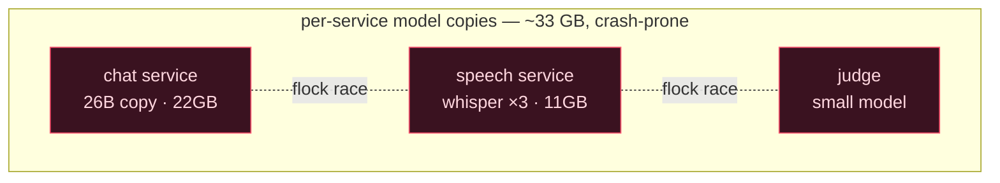
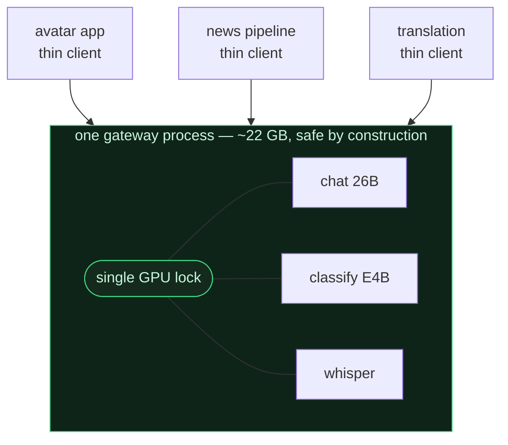
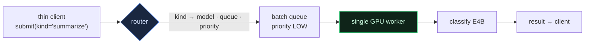
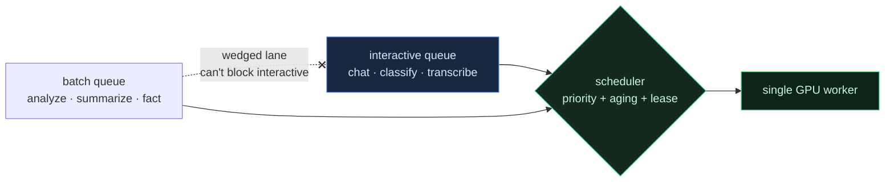
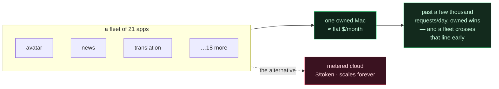

[🇺🇸 English](README.md) · [🇰🇷 한국어](README.ko.md) · [🇯🇵 日本語](README.ja.md) · [🇨🇳 简体中文](README.zh.md)

# Fleet Inference Gateway

**Apple Silicon Mac 한 대에서 추론 프로세스를 둘 돌리면 서로 크래시난다. 이걸 역이용한다 — 한 프로세스가 GPU 전체를 소유하게 하고, 모델이 아니라 역할로 부르며, fleet 전체의 chat·분류·음성을 기계 한 대로, 전기값에 돌린다.**

> [**NSKit**](https://github.com/nskit-io/nskit-io) 에서 사용 중 — *구조에는 묶이되, 조합은 자유롭게.* NSKit 온프렘 추론의 게이트웨이로, Mac Studio 한 대가 아바타 chat·뉴스/팩트 파이프라인·번역을 21개 앱 fleet에 서빙하며, 종량제 API 청구서가 없다.

> 한 프로세스가 모든 모델을 소유한다. 나머지는 전부 thin HTTP client. GPU는 **모델명이 아니라 역할(kind)로** 부른다.

**Fleet Inference Gateway** 는 여러 앱의 추론을 unified-memory GPU 한 개로 서빙하기 위한 아키텍처 패턴이다. 의존성 없는 레퍼런스 구현이 함께 온다. 설치해서 쓰는 서버가 아니라, 어느 언어로든 지을 수 있는 형태다. 레퍼런스는 GPU 없이 어디서든 돌아가므로, 스케줄러가 움직이는 걸 직접 볼 수 있다.

---

## 목차

- [제약 — Apple Silicon에선 모델 서버를 N개 그냥 못 띄운다](#제약--apple-silicon에선-모델-서버를-n개-그냥-못-띄운다)
- [순진한 해법들과 그 비용](#순진한-해법들과-그-비용)
- [패턴 — 소유자 하나, thin client 여럿](#패턴--소유자-하나-thin-client-여럿)
- [GPU를 모델이 아니라 역할로 지정한다](#gpu를-모델이-아니라-역할로-지정한다)
- [혼합 fleet 스케줄링](#혼합-fleet-스케줄링)
- [경제학 — 소유한 기계 하나 vs 종량제 청구서](#경제학--소유한-기계-하나-vs-종량제-청구서)
- [레퍼런스 코드](#레퍼런스-코드)
- [Ollama · vLLM · LiteLLM 과는 무엇이 다른가](#ollama--vllm--litellm-과는-무엇이-다른가)
- [언제 쓰고, 언제 쓰지 말아야 하는가](#언제-쓰고-언제-쓰지-말아야-하는가)
- [링크](#링크)

---

## 제약 — Apple Silicon에선 모델 서버를 N개 그냥 못 띄운다

데이터센터 GPU라면 추론 프로세스 여러 개를 나란히 띄우고 드라이버가 중재하게 두면 된다 — NVIDIA는 MPS·MIG로 카드 하나를 테넌트별로 쪼개 준다. Apple Silicon은 그중 아무것도 안 준다.

- **두 프로세스가 Metal GPU를 동시에 때리면 command buffer에서 레이스가 나며 크래시난다.** "느려진다"가 아니라 크래시. (직접 데어 봄.)
- 프로세스 간 GPU를 나눠 줄 **MPS/MIG가 없다.**
- **Unified memory**라 메모리 격리도 없다 — 모델을 로드하는 프로세스마다 가중치 사본을 통째로 RAM에 얹는다.

그래서 "서비스마다 모델 서버를 하나씩" 이라는 뻔한 구조는, Apple Silicon에선 메모리를 낭비할 뿐 아니라 **아예 위험하다.** 누군가는 GPU를 직렬화해야 하고, 그걸 깔끔히 할 유일한 자리는 *한 프로세스 안*이다.

## 순진한 해법들과 그 비용

**서비스마다 자기 모델을 로드.** 짜기는 제일 쉽고 운영은 제일 나쁘다. 실제 fleet 기준: chat 서비스가 26B(~22GB)를, 음성 서비스가 Whisper를 3-worker 풀(~11GB)로, judge가 작은 모델을 — 각자 unified memory에 사본을 통째로 얹고, 둘이 동시에 터지면 Metal 크래시 위험.

**프로세스 분리 + file lock.** `flock`으로 프로세스 간 GPU 접근을 직렬화. 동작은 한다 — 그리고 프로세스마다 중복된 가중치 비용, cross-process lock 큐 대기 비용, 모델 소유가 흩어져 운영이 추측 게임이 되는 비용을 계속 낸다.



## 패턴 — 소유자 하나, thin client 여럿

**모든** 모델을 **한** 프로세스에 넣는다. 그 프로세스가 GPU의 유일한 소유자다. 모든 추론을 in-process 락 하나 뒤로 직렬화하고, 각 모델을 정확히 한 번만 로드한다. 나머지 서비스는 전부 ~0.1GB짜리 thin HTTP client가 된다.



실제 배포에서 이 전환으로 fleet이 **~33GB → ~22.5GB**(모델을 서비스마다가 아니라 한 번만 로드)로, thin-client **부팅이 ~8초 → ~1초**(로드할 모델 없음)로 줄었다. Metal 크래시는 구조적으로 사라진다: 한 프로세스, 락 하나, 커널이 동시에 둘 도는 일 없음.

레퍼런스는 그 보증을 검증 가능하게 만든다 — worker가 `max_inflight`를 추적하고, 전체 테스트가 스무 개 client가 동시에 밀어넣어도 그 값이 **1**을 넘지 않음을 assert한다.

## GPU를 모델이 아니라 역할로 지정한다

thin client는 자기 일을 *어느* 모델이 하는지 몰라도 된다 — 무슨 일을 원하는지만 알면 된다. 그래서 API는 **kind**로 부른다: `chat`, `classify`, `transcribe`, `summarize`, `analyze`, `fact`. 라우터가 각 kind를 모델·큐·우선순위로 매핑한다.



두 가지 이득. 첫째, **모델군이 이종(heterogeneous)이다**: 어려운 추론은 26B, 값싼 구조화 추출(배치 작업의 80~90%)은 작은 모델, 그리고 음성 모델 — 서로 다른 모달리티가 락 하나·스케줄 하나 뒤에. 둘째, **라우팅은 client 코드가 아니라 테이블이다**: `summarize`를 작은 모델에서 큰 모델로 옮기거나, 붐비는 kind 하나를 별도 큐로 떼어내는 걸 라우터만 고쳐서 한다 — 모든 client는 손 안 대고 따라온다.

## 혼합 fleet 스케줄링

실시간 아바타 응답과 5만 행 배치 백필은 정반대를 원한다: 하나는 지금 당장의 낮은 지연을, 다른 하나는 언젠가의 처리량을. 이 둘을 한 레인에 태우면 배치 홍수가 사람을 기다리게 만든다. 프로덕션에서 값을 치르고 배운 교훈 둘:

**레인을 격리해, 멈춘 레인이 살아있는 레인을 못 막게 한다.** 공유된 "chat" 큐 하나가 한 번 처박힌 적이 있다 — submitted 11,183 / completed 0, 락이 끝내 안 풀림 — 그동안 목적별 큐들은 멀쩡히 드레인됐다. 해법은 구조적이었다: 실시간 작업에 자기 큐를 주고, 배치 작업은 kind별 별도 큐로 라우팅해, 오염된 레인 하나가 fleet 전체를 끌고 넘어지지 못하게.

**배치가 실시간 레인을 굶기지 않으면서 버스트하게 한다.** 엄격한 우선순위 아래선 chat이 하나라도 대기 중이면 큰 백필이 영영 안 돈다. 그래서 배치 작업의 유효 우선순위는 기다릴수록 *상승(aging)*하고 — 굶주린 저순위 작업이 결국 갓 들어온 실시간 작업을 앞선다 — 짧은 수명의 **lease**가 대량 작업을 일부러 빨리 빼고 싶을 때 배치 클래스 전체를 부스트한다. 레퍼런스에선 작은 점수식 하나가 둘 다 한다:

```python
def _score(self, job, now):
    waited = now - job.submit_t
    bonus = waited / self.aging_s                 # 굶주린 작업이 기어오른다
    if job.priority == LOW and self._lease_active(now):
        bonus += self._lease.boost                # lease가 배치를 버스트시킨다
    return float(job.priority) - bonus            # 낮을수록 먼저
```



`python examples/demo.py`가 정확히 이걸 재현한다 — 배치 백로그, 그다음 홍수 한복판에 도착하는 chat과 음성 — 그리고 완료 순서를 찍는다: 실시간이 큐를 제치고, 배치는 그래도 드레인되며, `max_inflight`는 1을 유지한다.

### 그다음에 온 것: 백프레셔, 그리고 거절

우선순위와 aging 은 *누가 먼저 갈지*를 정한다. *받을지 말지*는 정하지 않는다.
fleet 규모에서 늘어나기만 하는 큐는 결국 거짓말을 한다 — 호출자가 쓸모 있는 시간 안에
돌지 않을 작업을 기다리게 된다.

이 패턴이 나온 배포는 이제 큐 압력을 점수로 재고, 조용히 쌓는 대신 **거절하거나 승격**한다.
실시간 레인이 부하를 받으면 낮은 우선순위 작업은 미루거나 별도의 구독 기반 워커 풀로 넘긴다.
핵심은 특정 정책이 아니라 그 형태다 — **수용은 판단이고, 호출자에게 알린다.**
언제나 받는 게이트웨이는 자기 실패를 남의 타임아웃으로 떠넘기는 게이트웨이다.

## 경제학 — 소유한 기계 하나 vs 종량제 청구서

지연은 이걸 *만들* 이유고, 청구서는 이게 *중요한* 이유다. 소유한 Apple Silicon 기계는 월 비용이 거의 평평하다 — 수명으로 나눈 하드웨어 상각 + 전기. 종량제 API는 토큰마다, 영원히, 비용이 커진다.



`python examples/economics.py`가 이 back-of-envelope 모델을 돌린다. Mac Studio를 3년으로 상각하고 중간급 GPT-class API를 100만 토큰당 $0.60/$2.40로 잡으면 break-even은 대략 **~3,000 요청/일**에 걸린다 — 어떤 단일 앱은 못 미쳐도 *fleet*에는 하찮은 수치다. 그 선을 넘으면 기계가 조금 싼 정도가 아니라, fleet 볼륨에선 매달 한 자릿수 배수로 싸다. Unified memory가 이걸 가능케 한다: 이종 모델군이 한 주소공간에 *공존*하고, 직렬화가 크래시를 막고, 역할 라우팅이 호출자를 단순하게 유지한다.

## 레퍼런스 코드

[`src/gateway/`](src/gateway/)에 의존성 없는 Python — 단일 소유 GPU worker, 역할 라우터, 굶주림 방지 스케줄러, 처음부터 끝까지 읽히는 ~250줄. 모델은 대표 시간만큼 sleep하는 스텁이라, GPU도 MLX도 없이 전체가 돈다.

```python
from src.gateway import Gateway, default_models

gw = Gateway(default_models()).start()          # 한 프로세스가 (스텁) GPU를 소유

reply = gw.call("chat", {"input": "hello"})     # 실시간 — HIGH 우선순위
gw.submit("analyze", {"input": doc})            # 배치 — LOW, chat을 막지 않음
gw.acquire_batch_lease(boost=8.0, ttl_s=30)     # 백필을 30초간 버스트 허용

print(gw.report()["max_inflight"])              # 1 — 안전 불변식
```

```bash
python examples/demo.py         # 혼합 fleet: 실시간이 배치 백로그를 제친다
python examples/economics.py    # 소유 기계 vs 종량제 클라우드 break-even
python -m pytest test/          # max_inflight==1 · 우선순위 · 굶주림 방지 assert
```

## Ollama · vLLM · LiteLLM 과는 무엇이 다른가

다 좋은 도구고, 맞는 자리에 쓰면 된다. 겹치는 부분은 정직하게:

- **Ollama**도 한 프로세스로 돌고 여러 모델을 가질 수 있다 — 단일 프로세스 아이디어는 novel하지 않고, "로컬 LLM 돌리기"만 필요하면 그걸 잡아라. 이 패턴이 더하는 건 모달리티를 넘나드는 **이종** 모델군(LLM + 음성)을 한 스케줄 뒤에 두는 것, **역할 주소지정**(kind는 네가 고르는 모델명이 아니라, 모델·큐가 고정된 작업), 그리고 실시간·대량 호출자가 섞인 상황에 맞춘 **fleet 인지 스케줄링**(큐 격리 + aging + 배치 lease)이다.
- **vLLM / TGI**는 *한* 모델의 처리량을 무거운 배칭으로 극대화한다 — 다른 일이다. 이건 *여러 개의 작은 이종* 모델이 소비자용 unified-memory GPU *하나*를 안전하게 나눠 쓰는 얘기다.
- **LiteLLM / 게이트웨이**는 *원격* 프로바이더 엔드포인트를 라우팅한다. 이건 소유한 기계 한 대의 *로컬* 모델을 라우팅하며, 핵심은 애초에 토큰당 청구서가 없다는 것이다.

여기서 진짜로 특수한 프레이밍: 단일 프로세스의 **Apple Silicon 정합성 근거**(Metal 레이스, MPS/MIG 부재), 그리고 **fleet 경제학** — 앱 포트폴리오의 종량제 청구서를 소유한 기계 한 대로 대체한다는 것.

## 언제 쓰고, 언제 쓰지 말아야 하는가

- **쓸 때** — 여러 앱의 추론을 자기 Apple Silicon 하드웨어에서 돌리며 GPU 하나를 안전하게 나눠 쓰고 싶을 때. 특히 실시간과 배치가 섞이고 모달리티가 둘 이상일 때.
- **쓸 때** — fleet 총 볼륨이 종량제 API 대비 break-even을 넘었고, 그 비용을 소유하고 싶을 때.
- **건너뛸 때** — 관리형 클라우드의 모델 하나로 충분하거나, 단일 앱 트래픽이 튀고 낮을 때. 운영 안 하는 종량제 API가, 운영해야 하는 기계보다 싸다.
- **이종성은 건너뛸 때** — 정말 모델 하나만 필요하면, Ollama나 단일 vLLM 서버가 운영 부담이 적다.

## 링크

- [**NSKit**](https://github.com/nskit-io/nskit-io) — 이 게이트웨이가 서빙하는 fleet
- [**ai-native-design**](https://github.com/nskit-io/ai-native-design) — 소유한 로컬 추론 위에 짓는다는 철학
- 제작 [Neoulsoft Inc.](https://neoulsoft.com) — 서울, 2019 설립

## 라이선스

MIT © Neoulsoft Inc. [LICENSE](LICENSE) 참조.
