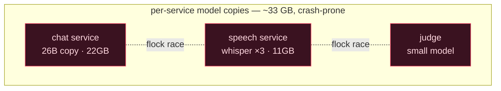
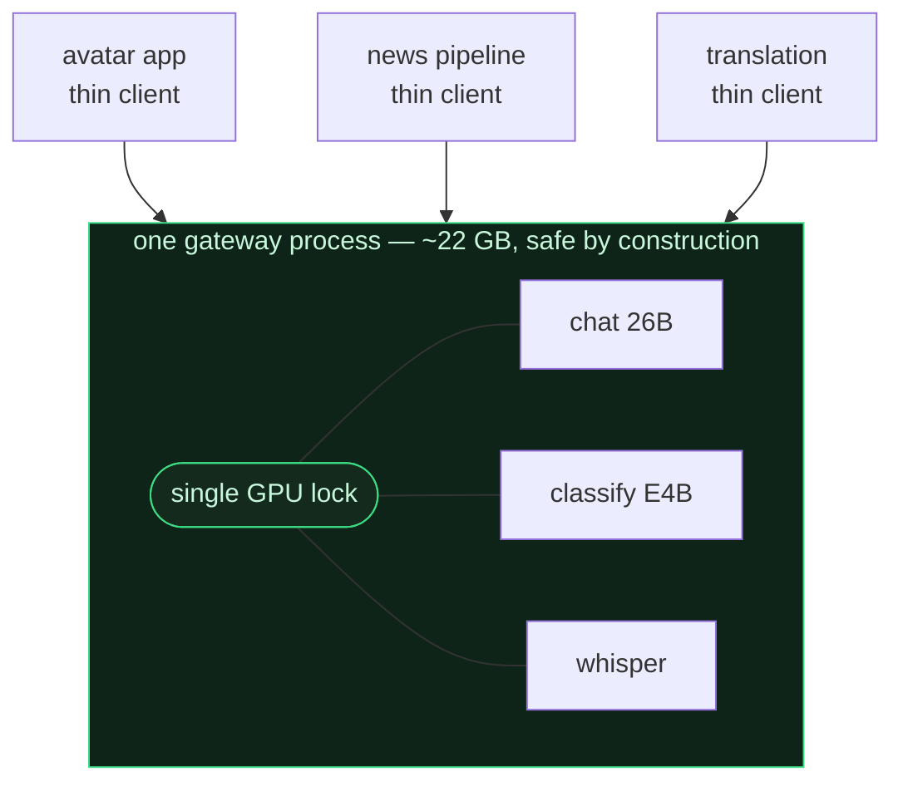
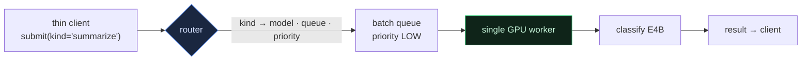
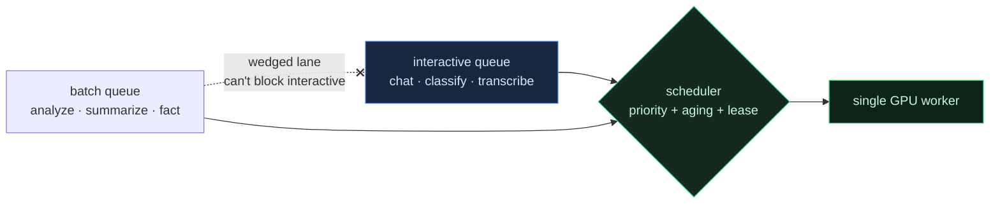
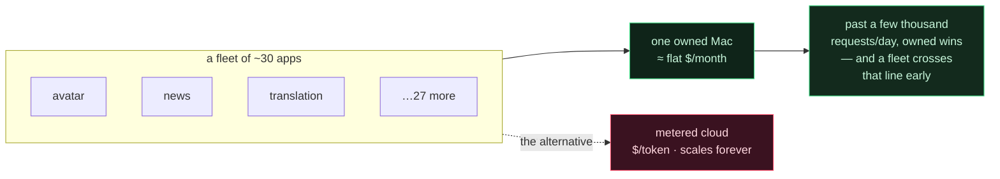

[🇺🇸 English](README.md) · [🇰🇷 한국어](README.ko.md) · [🇯🇵 日本語](README.ja.md) · [🇨🇳 简体中文](README.zh.md)

# Fleet Inference Gateway

**Two inference processes on one Apple-Silicon Mac will crash each other. Turn that into an advantage: make one process the whole GPU, address it by role, and run a fleet's chat, classification, and speech from a single machine — for the price of the electricity.**

> Used by [**NSKit**](https://github.com/nskit-io/nskit-io) — *bound by structure, free to combine.* This is the gateway behind NSKit's on-prem inference: one Mac Studio serving avatar chat, a news/fact pipeline, and translation across a fleet of ~30 apps, with no metered API bill.

> One process owns every model. Everyone else is a thin HTTP client. The GPU is addressed by **role**, not by model name.

**Fleet Inference Gateway** is an architecture pattern — with a dependency-free reference implementation — for serving many apps' inference from a single unified-memory GPU. It is not a server you install; it is a shape you can build in any language. The reference runs anywhere, no GPU required, so you can watch the scheduler work.

---

## Table of Contents

- [The constraint: you can't just run N model servers on Apple Silicon](#the-constraint-you-cant-just-run-n-model-servers-on-apple-silicon)
- [The naive fixes, and what they cost](#the-naive-fixes-and-what-they-cost)
- [The pattern: one owner, many thin clients](#the-pattern-one-owner-many-thin-clients)
- [Address the GPU by role, not by model](#address-the-gpu-by-role-not-by-model)
- [Scheduling a mixed fleet](#scheduling-a-mixed-fleet)
- [The economics: one machine vs a metered bill](#the-economics-one-machine-vs-a-metered-bill)
- [Reference code](#reference-code)
- [How this differs from Ollama / vLLM / LiteLLM](#how-this-differs-from-ollama--vllm--litellm)
- [When to use it — and when not to](#when-to-use-it--and-when-not-to)
- [Links](#links)

---

## The constraint: you can't just run N model servers on Apple Silicon

On a datacenter GPU you'd run several inference processes side by side and let the driver arbitrate — NVIDIA gives you MPS and MIG to partition one card across tenants. Apple Silicon gives you none of that:

- **Two processes hitting the Metal GPU concurrently race on the command buffer and crash.** Not "slow down" — crash. (Learned the hard way.)
- There is **no MPS/MIG** to slice the GPU across processes.
- **Unified memory** means there's no memory isolation either — every process that loads a model pays full RAM for its own copy of the weights.

So the obvious architecture — "give each service its own model server" — doesn't just waste memory on Apple Silicon; it's actively unsafe. Something has to serialize the GPU, and the only clean place to do it is *inside one process*.

## The naive fixes, and what they cost

**Each service loads its own model.** Simplest to write, worst to run. On a real fleet: a chat service holding a 26B model (~22GB), a speech service holding Whisper across a 3-worker pool (~11GB), a judge holding a small model — each a full copy in unified memory, and any two firing at once risk the Metal crash.

**Separate processes + a file lock.** Serialize GPU access with `flock` across processes. It works — and you still pay for duplicated weights in every process, plus the cost of a cross-process lock queue, plus scattered model ownership that makes ops a guessing game.



## The pattern: one owner, many thin clients

Put **every** model in **one** process. That process is the sole owner of the GPU; it serializes all inference behind a single in-process lock, and loads each model exactly once. Every other service becomes a thin HTTP client with a ~0.1GB footprint.



On a real deployment this took the fleet from **~33 GB to ~22.5 GB** (each model loaded once, not per service) and thin-client **boot from ~8s to ~1s** (no model to load). The Metal crash is gone by construction: one process, one lock, never two kernels at once.

The reference makes that guarantee testable — the worker tracks `max_inflight`, and the whole test suite asserts it never exceeds **1**, even when twenty clients submit at once.

## Address the GPU by role, not by model

A thin client should not have to know *which* model does its job — only what job it wants done. So the API is keyed by a **kind**: `chat`, `classify`, `transcribe`, `summarize`, `analyze`, `fact`. A router maps each kind to a model, a queue, and a priority.



Two payoffs. First, **the group is heterogeneous**: a 26B model for hard reasoning, a small model for cheap structured extraction (80–90% of batch work), and a speech model — different modalities, one lock, one schedule. Second, **routing is a table, not client code**: move `summarize` from the small model to the big one, or split one busy kind into its own queue, by editing the router — every client follows, untouched.

## Scheduling a mixed fleet

An interactive avatar reply and a 50,000-row batch backfill want opposite things: one needs low latency now, the other needs throughput eventually. Run them through one lane and the batch flood makes the person wait. Two lessons, both paid for in production:

**Isolate queues so a stalled lane can't block a live one.** A single shared "chat" queue once wedged — 11,183 jobs submitted, 0 completed, the lock never released — while every purpose-specific queue kept draining normally. The fix was structural: give interactive work its own queue, and route batch work through separate per-kind queues, so one poisoned lane can never take the fleet down with it.

**Let batch burst without starving the interactive lane.** Under strict priority a big backfill would never run while any chat is pending. So a batch job's effective priority *ages up* as it waits — a starving low-priority job eventually outranks fresh interactive work — and a short-lived **lease** can boost the whole batch class when you deliberately want a bulk job to drain fast. In the reference, one small scoring expression does both:

```python
def _score(self, job, now):
    waited = now - job.submit_t
    bonus = waited / self.aging_s                 # a starving job climbs
    if job.priority == LOW and self._lease_active(now):
        bonus += self._lease.boost                # a lease lets batch burst
    return float(job.priority) - bonus            # lower = served sooner
```



`python examples/demo.py` fires exactly this — a batch backlog, then chat and speech arriving mid-flood — and prints the finish order: interactive jumps the queue, the batch still drains, and `max_inflight` stays 1.

## The economics: one machine vs a metered bill

Latency is the reason you'll *build* it; the bill is the reason it *matters*. An owned Apple-Silicon machine has a near-flat monthly cost — hardware amortized over its life, plus power. A metered API scales with every token, forever.



`python examples/economics.py` runs the back-of-envelope model. With a Mac Studio amortized over three years and a mid GPT-class API at $0.60/$2.40 per 1M tokens, break-even lands around **~3,000 requests/day** — trivial for a *fleet*, even if no single app would reach it. Above that line the machine isn't a little cheaper; at fleet volume it's cheaper by an order of magnitude, month after month. Unified memory is what makes it work: a heterogeneous group of models *coexists* in one address space; serialization keeps them from crashing; role-routing keeps the callers dumb.

## Reference code

Dependency-free Python in [`src/gateway/`](src/gateway/) — a single-owner GPU worker, a role router, and a starving-avoidance scheduler, ~250 lines you can read end to end. The models are stubs that sleep for a representative time, so the whole thing runs with no GPU and no MLX.

```python
from src.gateway import Gateway, default_models

gw = Gateway(default_models()).start()          # one process owns the (stub) GPU

reply = gw.call("chat", {"input": "hello"})     # interactive — HIGH priority
gw.submit("analyze", {"input": doc})            # batch — LOW, won't block chat
gw.acquire_batch_lease(boost=8.0, ttl_s=30)     # let a backfill burst for 30s

print(gw.report()["max_inflight"])              # 1 — the safety invariant
```

```bash
python examples/demo.py         # mixed fleet: interactive jumps a batch backlog
python examples/economics.py    # owned-machine vs metered-cloud break-even
python -m pytest test/          # asserts max_inflight==1, priority, anti-starvation
```

## How this differs from Ollama / vLLM / LiteLLM

Those are good tools; use them where they fit. Being honest about the overlap:

- **Ollama** also runs as one process and can hold several models — the single-process idea is not novel, and if all you need is "run a local LLM," reach for it. What this pattern adds is a **heterogeneous** group across modalities (LLM + speech) behind one schedule, **role-addressed** kinds (a kind is a fixed job with a pinned model and queue, not a model name you pick), and **fleet-aware scheduling** (queue isolation + aging + a batch lease) tuned for a mix of interactive and bulk callers.
- **vLLM / TGI** maximize throughput for *one* model with heavy batching — a different job. This is about *many small heterogeneous* models sharing *one* consumer-grade unified-memory GPU safely.
- **LiteLLM / gateways** route across *remote* provider endpoints. This routes across *local* models on a single owned machine, where the whole point is that there is no per-token bill.

The framing that's genuinely specific here: the **Apple-Silicon correctness reason** for single-process (the Metal race, no MPS/MIG), and the **fleet economics** — replacing a metered bill for a portfolio of apps with one machine you own.

## When to use it — and when not to

- **Use it when** you run several apps' inference on your own Apple-Silicon hardware and want them to share one GPU safely — especially a mix of interactive and batch work, and more than one modality.
- **Use it when** your fleet's aggregate volume is past the break-even against a metered API and you'd rather own the cost.
- **Skip it when** one model on managed cloud serves you fine, or a single app's traffic is spiky and low — a metered API you never operate is cheaper than a machine you do.
- **Skip the heterogeneity when** you truly only need one model — then Ollama or a single vLLM server is less to run.

## Links

- [**NSKit**](https://github.com/nskit-io/nskit-io) — the fleet this gateway serves
- [**ai-native-design**](https://github.com/nskit-io/ai-native-design) — the philosophy behind building on owned, local inference
- Built by [Neoulsoft Inc.](https://neoulsoft.com) — Seoul, est. 2019

## License

MIT © Neoulsoft Inc. See [LICENSE](LICENSE).
