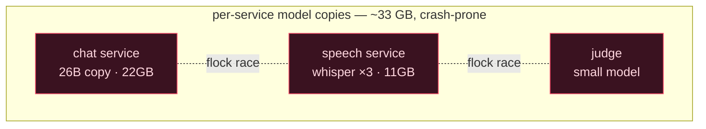
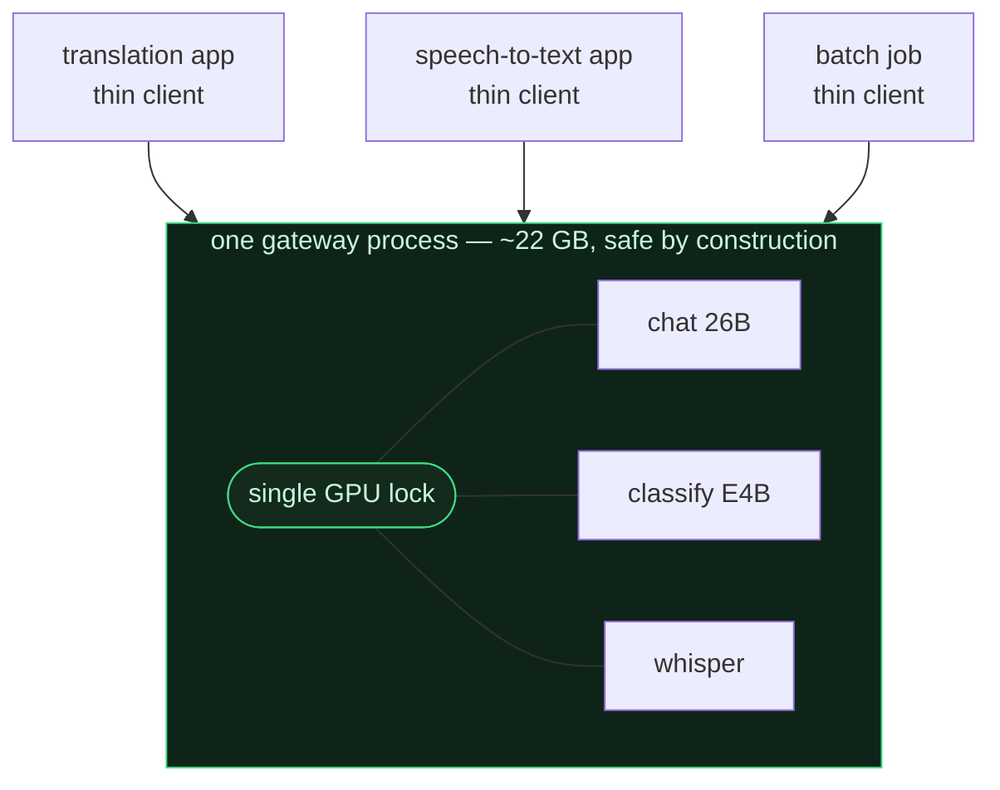
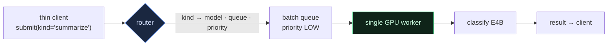
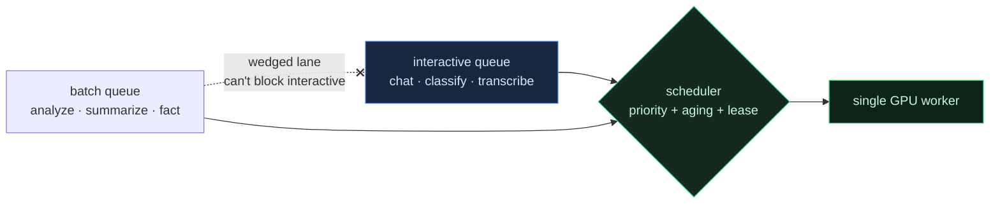
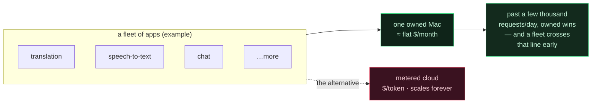

[🇺🇸 English](README.md) · [🇰🇷 한국어](README.ko.md) · [🇯🇵 日本語](README.ja.md) · [🇨🇳 简体中文](README.zh.md)

# Fleet Inference Gateway

**在一台 Apple Silicon Mac 上跑两个推理进程，它们会互相搞崩。把这个约束反过来用——让一个进程独占整块 GPU，按角色而非模型去调用它，用一台机器跑起整个 fleet 的 chat、分类和语音——花的只是电费。**

> [**NSKit**](https://github.com/nskit-io/nskit-io) 正在使用 — *受结构约束，组合自由。* 这是 NSKit 自建推理的模式：一台 Apple Silicon 机器为一支应用 fleet 供给推理（目前主要是翻译和语音转文字（STT）类工作负载），没有一分钱按量计费的 API 账单。

> 一个进程独占所有模型。其余全是 thin HTTP client。GPU 是**按角色（kind）调用的，而不是按模型名**。

**Fleet Inference Gateway** 是一种架构模式，用来让多个应用的推理共享同一块 unified-memory GPU，并附带一份零依赖的参考实现。它不是一个装来就用的服务器，而是一种可以用任何语言搭起来的「形状」。参考实现在没有 GPU 的任何机器上都能跑，让你直接看到调度器在工作。

---

## 目录

- [约束 — Apple Silicon 上你没法直接起 N 个模型服务器](#约束--apple-silicon-上你没法直接起-n-个模型服务器)
- [常见的对策，以及它们的代价](#常见的对策以及它们的代价)
- [模式 — 一个所有者，多个 thin client](#模式--一个所有者多个-thin-client)
- [按角色而非模型来寻址 GPU](#按角色而非模型来寻址-gpu)
- [调度一支混合 fleet](#调度一支混合-fleet)
- [经济账 — 自有一台 vs 按量计费的账单](#经济账--自有一台-vs-按量计费的账单)
- [参考代码](#参考代码)
- [与 Ollama · vLLM · LiteLLM 有何不同](#与-ollama--vllm--litellm-有何不同)
- [何时用，何时不要用](#何时用何时不要用)
- [链接](#链接)

---

## 约束 — Apple Silicon 上你没法直接起 N 个模型服务器

在数据中心 GPU 上，你会并排跑好几个推理进程，让驱动去仲裁——NVIDIA 有 MPS 和 MIG，把一张卡按租户切开。Apple Silicon 一样都不给你：

- **两个进程同时打 Metal GPU，会在 command buffer 上竞争然后崩溃。** 不是「变慢」，是崩溃。（亲身踩过。）
- 没有 **MPS/MIG** 把 GPU 在进程间切分。
- **unified memory** 意味着连内存隔离也没有——每个加载模型的进程都得为自己那份权重付满内存。

所以「每个服务自带一个模型服务器」这个理所当然的架构，在 Apple Silicon 上不只是浪费内存，而是**根本不安全**。总得有人把 GPU 串行化,而唯一能干净利落地做到这点的地方,就是*同一个进程之内*。

## 常见的对策，以及它们的代价

**每个服务各自加载模型。** 最好写，最难运维。真实 fleet 里：chat 服务扛着 26B（约 22GB），语音服务用 3-worker 池扛 Whisper（约 11GB），judge 扛一个小模型——各自往 unified memory 里塞一整份副本，两个同时开火就有 Metal 崩溃之虞。

**进程分离 + 文件锁。** 用 `flock` 把跨进程的 GPU 访问串行化。能跑——同时你要一直付出每进程重复权重的代价、跨进程锁排队的代价，以及模型归属四散、运维变成猜谜的代价。



## 模式 — 一个所有者，多个 thin client

把**所有**模型放进**一个**进程。这个进程是 GPU 的唯一所有者；它把所有推理串行到一把进程内的锁之后，且每个模型只加载一次。其余每个服务都变成约 0.1GB 的 thin HTTP client。



在真实部署里，这一转变把 fleet 从**约 33GB 降到约 22.5GB**（模型只加载一次，而非每个服务一份），thin-client 的**启动从约 8 秒降到约 1 秒**（没有模型要加载）。Metal 崩溃在结构上消失了：一个进程，一把锁，绝不会有两个 kernel 同时跑。

参考实现让这条保证可被检验——worker 追踪 `max_inflight`，整套测试断言：即便二十个 client 同时投递，这个值也绝不超过 **1**。

## 按角色而非模型来寻址 GPU

thin client 不该需要知道*哪个*模型来干它的活——只需知道自己想要什么活干完。所以 API 是按 **kind** 调用的：`chat`、`classify`、`transcribe`、`summarize`、`analyze`、`fact`。路由器把每个 kind 映射到模型、队列和优先级。



两个好处。其一，**这组模型是异构的**：难推理交给 26B，廉价的结构化抽取（批处理里 80〜90% 的活）交给小模型，还有语音模型——不同模态,一把锁、一套调度。其二,**路由是一张表,而不是 client 代码**：把 `summarize` 从小模型挪到大模型、或把某个繁忙的 kind 拆到独立队列,都只改路由器——所有 client 原封不动地跟上。

## 调度一支混合 fleet

实时的 chat 回复和五万行的批量回填,想要的东西正相反：一个要此刻的低延迟,另一个要将来的吞吐。把两者塞进一条车道,批量洪水就会让人干等。两条在生产里付过代价的教训:

**隔离车道,让卡死的车道无法堵住活着的车道。** 一条共享的「chat」队列曾经卡死过——submitted 11,183 / completed 0,锁再没释放——而与此同时,各个专用队列照常清空。解法是结构性的:给实时活儿一条自己的队列,把批量活儿按 kind 路由到各自独立的队列,这样一条被污染的车道就没法拉着整个 fleet 一起翻。

**让批量能突发,却不饿死实时车道。** 在严格优先级下,只要还有一个 chat 在等,大回填就永远轮不上。于是批量活儿的有效优先级会随等待而*抬升(aging)*——一个快饿死的低优先级活儿终会超过新来的实时活儿——而一个短命的 **lease** 能在你故意想让某个大活儿快点排空时,给整个批量类加一把力。在参考实现里,一个小小的打分式同时做了这两件事:

```python
def _score(self, job, now):
    waited = now - job.submit_t
    bonus = waited / self.aging_s                 # 快饿死的活儿往上爬
    if job.priority == LOW and self._lease_active(now):
        bonus += self._lease.boost                # lease 让批量突发
    return float(job.priority) - bonus            # 越小越先
```



`python examples/demo.py` 正是复现这一幕——先是批量 backlog,然后 chat 和语音在洪水中途到达——并打印完成顺序:实时插到队前,批量照样清空,而 `max_inflight` 始终为 1。

### 接下来发生的：背压，以及学会拒绝

优先级与 aging 决定*谁先执行*，却不决定*是否受理*。
在 fleet 规模下，只增不减的队列最终会说谎——调用方在等一个不会在有效时间内跑起来的任务。

这一模式所来自的部署，现在会对队列压力进行打分，不再默默入队，而是**拒绝或升级**：
当实时通道处于负载时，低优先级工作要么延后，要么交给另一套基于订阅的 worker 池。
重点不在于具体策略，而在于它的形态——**受理是一个判断，并且要告知调用方。**
永远来者不拒的网关，是把自身失败推给别人超时的网关。

## 经济账 — 自有一台 vs 按量计费的账单

延迟是你*去做它*的理由,账单才是它*要紧*的理由。一台自有的 Apple Silicon 机器,月成本近乎平坦——按寿命摊销的硬件 + 电费。按量计费的 API 则随每一个 token、永远地增长。



`python examples/economics.py` 会跑这个粗算模型。把一台 Apple Silicon Mac 按三年摊销,中档 GPT 级 API 按每百万 token $0.60/$2.40 算,break-even 大约落在 **约 3,000 请求/天**——任何单个应用够不着,对一支 *fleet* 却是小数目。越过那条线,机器就不是便宜一点点:在 fleet 的量级上,它每个月要便宜一个数量级。unified memory 是它成立的关键:一组异构模型*共存*于同一地址空间,串行化防止它们崩溃,角色路由让调用方保持简单。

## 参考代码

[`src/gateway/`](src/gateway/) 里是零依赖的 Python——单一所有者的 GPU worker、角色路由器、防饿死调度器,从头读到尾约 250 行。模型是按代表性时长 sleep 的桩,所以整套东西无需 GPU、无需 MLX 就能跑。

```python
from src.gateway import Gateway, default_models

gw = Gateway(default_models()).start()          # 一个进程独占(桩)GPU

reply = gw.call("chat", {"input": "hello"})     # 实时 — HIGH 优先级
gw.submit("analyze", {"input": doc})            # 批量 — LOW,不会堵住 chat
gw.acquire_batch_lease(boost=8.0, ttl_s=30)     # 让回填突发 30 秒

print(gw.report()["max_inflight"])              # 1 — 安全不变量
```

```bash
python examples/demo.py         # 混合 fleet:实时插到批量 backlog 之前
python examples/economics.py    # 自有机器 vs 按量计费云的 break-even
python -m pytest test/          # 断言 max_inflight==1、优先级、防饿死
```

## 与 Ollama · vLLM · LiteLLM 有何不同

它们都是好工具,该用就用。重叠之处,说实话:

- **Ollama** 同样以一个进程运行,也能持有多个模型——单进程这个想法并不新鲜,如果你只要「跑个本地 LLM」,就用它。这套模式多出来的是:跨模态的**异构**模型组(LLM + 语音)置于同一套调度之后、**按角色调用**(kind 是一份模型与队列都固定的活儿,而不是你自己挑的模型名),以及为实时与批量调用方混杂而调的 **fleet 感知调度**(队列隔离 + aging + 批量 lease)。
- **vLLM / TGI** 用重批处理把*单个*模型的吞吐拉满——那是另一件事。这里说的是*多个小型异构*模型,安全地共享*一块*消费级 unified-memory GPU。
- **LiteLLM / 网关** 路由的是*远程*供应商端点。这里路由的是自有一台机器上的*本地*模型,而要点恰恰是压根没有按 token 的账单。

这里真正独有的定位:单进程在 **Apple Silicon 上的正当性依据**(Metal 竞争、没有 MPS/MIG),以及 **fleet 经济学**——用一台自有机器,替掉一整组应用的按量计费账单。

## 何时用，何时不要用

- **该用** —— 当你在自己的 Apple Silicon 硬件上跑多个应用的推理,想让它们安全共享一块 GPU 时。尤其当实时与批量混杂、模态不止一种时。
- **该用** —— 当 fleet 的总量已越过按量计费 API 的 break-even,而你更愿意把这笔成本握在自己手里时。
- **跳过** —— 当托管云上一个模型就够用时,或单个应用流量又尖又低时。一个你不必运维的按量计费 API,比一台你得运维的机器更便宜。
- **跳过异构** —— 如果你真的只要一个模型,那 Ollama 或单个 vLLM 服务器运维更轻。

## 链接

- [**NSKit**](https://github.com/nskit-io/nskit-io) —— 这个网关所供给的 fleet
- [**ai-native-design**](https://github.com/nskit-io/ai-native-design) —— 建立在自有本地推理之上的理念
- 由 [Neoulsoft Inc.](https://neoulsoft.com) 打造 —— 首尔,成立于 2019 年

## 许可证

MIT © Neoulsoft Inc. 见 [LICENSE](LICENSE)。
